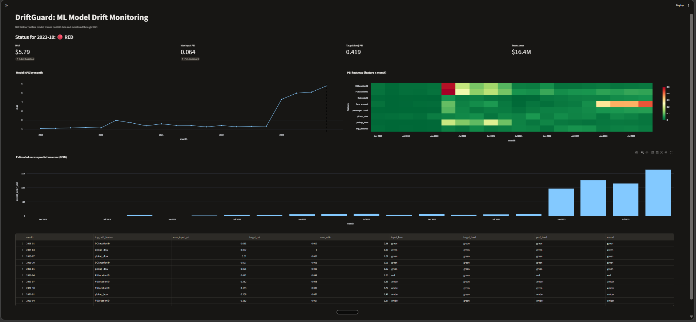

# DriftGuard: ML Model Drift Detection and Monitoring

DriftGuard monitors a fare-prediction model after deployment. It trains an XGBoost model on NYC Yellow Taxi trips from 2019, then tracks input drift, target drift and model performance across 20 months of real data (2019 to 2023, about 73 million trips).

## Headline results

- The model's MAE rose from about $1.13 (2019 baseline) to $5.79 in 2023-10, which is 5.1x the baseline.
- In 2023 the model under-predicted fares by up to 28%, while input feature drift stayed low (PSI under 0.07). Monitoring inputs alone would have missed it. Only target drift and performance monitoring caught it.
- In 2020-04 (COVID), input drift was severe (location PSI 0.64) but the money impact was small because trip volume collapsed by 97%.
- Estimated excess prediction error over the 20 sampled months is about $57.2M, and the four 2023 months account for about 88% of it.
- Retraining on recent months cut MAE from $5.44 to $2.65 (51% better) on two unseen months, so the challenger model was promoted.

## Project structure

    src/
      download_data.py     download NYC taxi parquet files
      build_dataset.py     clean and sample the modelling dataset
      train_baseline.py    train the 2019 baseline XGBoost model
      score_months.py      score every month, measure performance decay
      drift_engine.py      PSI, KS, Wasserstein and Cramer's V
      evidently_reports.py Evidently HTML drift reports
      severity.py          green / amber / red status per month
      shap_analysis.py     SHAP root cause analysis
      business_impact.py   model error converted to dollars
      track_mlflow.py      MLflow experiment tracking
      retrain.py           champion vs challenger retraining
      api.py               FastAPI service
      dashboard.py         Streamlit dashboard
      alerts.py            Slack / email alerts for red status
    tests/                 pytest unit tests for the drift engine
    reports/               CSV outputs and charts

## Tech stack

Python, DuckDB (SQL on Parquet), Pandas, Scikit-learn, XGBoost, SciPy, Evidently, SHAP, MLflow, FastAPI, Streamlit, Plotly, Pytest, GitHub Actions.

## How to run

    python -m venv venv
    venv\Scripts\activate
    pip install -r requirements.txt
    python src\download_data.py 2019-01 2019-04 2019-07 2019-10 2020-01 2020-04 2020-07 2020-10 2021-01 2021-04 2021-07 2021-10 2022-01 2022-04 2022-07 2022-10 2023-01 2023-04 2023-07 2023-10
    python src\build_dataset.py
    python src\train_baseline.py
    python src\score_months.py
    python src\drift_engine.py
    python src\severity.py
    streamlit run src\dashboard.py

Note: `data/` and `models/` are not stored in Git, so run the steps above to recreate them.

## Dashboard

The Streamlit dashboard shows the status for any month: model error, input drift, target drift, a PSI heatmap and the estimated excess error in dollars. The screenshot shows 2023-10, which is red.

## Results by period

| Period | MAE | Status | What happened |
|---|---|---|---|
| 2019 (baseline) | about $1.13 | green | Normal. These months include training rows. |
| 2020-04 (COVID) | $1.98 | red | Severe input drift (location PSI 0.64), trips down 97% |
| 2021-07 to 2022-10 | $1.26 to $1.41 | green | Recovered |
| 2023-01 | $4.30 | red | Target drift begins, model under-predicts by 23% |
| 2023-10 | $5.79 | red | MAE is 5.1x baseline, under-prediction 28% |

Status combines three signals: input drift (PSI), target drift (PSI on fare) and model error relative to baseline. Thresholds: PSI 0.10 amber and 0.25 red, MAE 1.25x amber and 1.75x red.

## Limitations

- Data is a sample: up to 200,000 clean trips per month, and only 4 months per year (20 months in total).
- The 2019 months are partly training data, so their error is slightly better than true out-of-sample error.
- The dollar figures are estimated excess prediction error, not lost revenue.
- The fare level jump in 2023 is shown in the data, but its cause was not verified against official fare rules.
- The challenger model was trained on only 3 months. It recovered about half of the excess error, not all of it.
- The Dockerfile is included but was not tested on the author's machine.
- Alerts run in dry-run mode unless Slack or email credentials are set.

